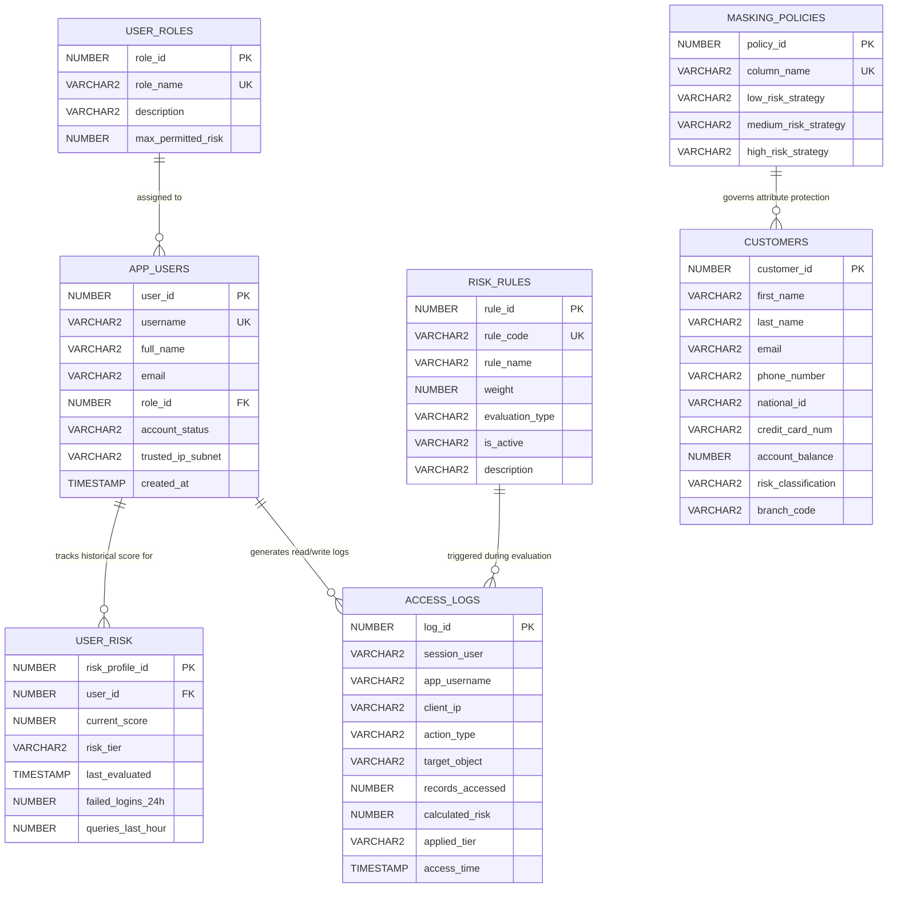

# Implementation Plan: Context-Aware Dynamic Data Masking System Using Oracle PL/SQL

**Project Title:** Context-Aware Dynamic Data Masking System Using Oracle PL/SQL  
**Role:** Senior Database Security Engineer, Oracle PL/SQL Developer, and Technical Project Mentor  
**Target Environment:** Oracle Database Free (23c / 23ai) or Oracle Database 19c / 21c Express Edition (XE)  
**Status:** In Planning / Awaiting Approval to Begin Phase 1  
**Last Updated:** October 2026  

---

## Table of Contents
1. [Section A: Project Requirements](#section-a-project-requirements)
2. [Section B: System Architecture & Data Flow](#section-b-system-architecture--data-flow)
3. [Section C: Database Design & Schema Specifications](#section-c-database-design--schema-specifications)
4. [Section D: Risk Scoring Model & Context Evaluation](#section-d-risk-scoring-model--context-evaluation)
5. [Section E: Dynamic Data Masking Engine Design](#section-e-dynamic-data-masking-engine-design)
6. [Section F: Oracle Security Implementation & Deep-Dive Mechanics](#section-f-oracle-security-implementation--deep-dive-mechanics)
7. [Section G: Phased Implementation Plan & Progress Tracking](#section-g-phased-implementation-plan--progress-tracking)
8. [Section H: Comprehensive Testing Strategy & Test Matrix](#section-h-comprehensive-testing-strategy--test-matrix)
9. [Section I: Performance Benchmarking & Evaluation Methodology](#section-i-performance-benchmarking--evaluation-methodology)
10. [Section J: Recommended Project Structure](#section-j-recommended-project-structure)
11. [Section K: Technical Risks, Limitations, & Mitigations](#section-k-technical-risks-limitations--mitigations)
12. [Section L: Final Deliverables Checklist](#section-l-final-deliverables-checklist)

---

## Section A: Project Requirements

### 1. Problem Statement
In enterprise relational databases, sensitive customer and organizational data (such as Personally Identifiable Information [PII], national identifiers, contact records, and account balances) must be protected from unauthorized inspection. Traditional database security paradigms typically rely on static access controls:
- **Discretionary Access Control (DAC):** Grants `SELECT` privileges either on all columns or via static views.
- **Static Data Masking (SDM):** Permanently alters data in test or non-production environments, making it unsuitable for live transactional systems.
- **Static Column Redaction / Traditional Dynamic Masking:** Applies uniform masking rules purely on the basis of database role or static grants, regardless of environmental factors, temporal anomalies, or query volume.

**The Failure Mode of Static Security:** A compromised credential belonging to a trusted role (e.g., a customer care agent) accessing data at 02:00 AM from an unrecognized IP address, or pulling 10,000 records in seconds, receives the identical, unmasked plaintext view as an authorized agent operating during business hours from an office workstation. Conversely, setting permanently strict redaction impedes legitimate business tasks.

### 2. Project Objectives
1. **Context-Driven Policy Enforcement:** Design and implement a database-resident dynamic masking system where sensitive column exposure is continuously modulated by multi-factor session context and calculated operational risk.
2. **Three-Tier Risk-Adaptive Data Obfuscation:**
   - **Low Risk (Score 0–29):** Deliver full or role-authorized cleartext data according to user permissions.
   - **Medium Risk (Score 30–69):** Apply partial masking (e.g., masking middle digits of phone numbers, obfuscating email usernames, masking national identity numbers) preserving operational utility while preventing mass PII exfiltration.
   - **High Risk (Score 70–100):** Apply full masking/redaction (e.g., replacing strings with fixed tokens such as `[REDACTED]` or nullifying) and trigger high-priority security logging.
3. **Zero Data Corruption:** Guarantee that underlying database storage retains pristine, unmasked data at all times. All transformations occur ephemerally in volatile memory during query processing.
4. **Enforce Principle of Least Privilege & Strict Non-Escalation:** The dynamic masking layer must **never** reveal data beyond what the user's role and authorization permit, regardless of how low the calculated risk score is.
5. **Fail-Closed Security Architecture:** If context is missing, invalid, corrupt, or unauthenticated, the engine must default to complete masking or complete access denial.
6. **Academic Rigor & Production Distinction:** Differentiate between standard database features (e.g., Oracle VPD, Fine-Grained Auditing) and our custom risk-scoring and dynamic evaluation engine, maintaining technical transparency and avoiding inflated novelty claims.

### 3. Scope and Boundaries
- **In Scope:**
  - Oracle PL/SQL packages, functions, and autonomous audit procedures.
  - Application session context management via Oracle `SYS_CONTEXT` within an application namespace.
  - Row and column security using Oracle Virtual Private Database (`DBMS_RLS`) and secure abstraction views.
  - Fine-Grained Auditing (`DBMS_FGA`) and custom autonomous access event logging.
  - Rule-based risk scoring calculation accounting for time of day, client IP/subnet trust, record access velocity, and failed login history.
  - Comprehensive automated test scripts covering both positive functionality and negative attack scenarios.
  - Academic performance benchmark documentation.
  - *Optional Phase:* Lightweight Python FastAPI backend and responsive HTML5/CSS3 web dashboard for live interactive demonstration.
- **Out of Scope:**
  - Replacing commercial hardware-based network firewalls or TLS encryption layers.
  - Client-side browser-only masking (which is trivially bypassed via network inspection).
  - Unsupervised Machine Learning clustering within the core database kernel for the baseline prototype (rule-based deterministic scoring is implemented first; ML is purely an optional post-baseline study).
  - Direct modification of proprietary Oracle Database C-kernel binaries.

### 4. Functional Requirements (FR)
- **FR-1 [User & Identity Mapping]:** The system must securely distinguish between the database connection user (e.g., proxy or schema owner) and the verified end-user application identity.
- **FR-2 [Context Initialization]:** The system must provide a trusted PL/SQL API to initialize session context (`SYS_CONTEXT`) containing user ID, role, client IP address, workstation, and authentication timestamp.
- **FR-3 [Multi-Signal Risk Computation]:** The engine must calculate a normalized composite risk score (0 to 100) based on evaluated signals: off-hours access, untrusted network origin, high-frequency query bursts, and recorded security anomalies.
- **FR-4 [Dynamic Column Transformation]:** Masking functions must dynamically transform sensitive attributes (Phone, Email, National ID, Account Balance) into Cleartext, Partially Masked, or Fully Redacted output based on evaluated risk.
- **FR-5 [VPD Integration]:** Integrate masking with Oracle `DBMS_RLS` (Virtual Private Database) to enforce row-level security boundaries (e.g., branch-level data confinement) and dynamic column masking.
- **FR-6 [Immutable Audit Trail]:** Read events on sensitive tables and risk calculation outcomes must be persistently logged using autonomous transactions, ensuring audit records survive transaction rollbacks.
- **FR-7 [Fail-Closed Default]:** Any error during risk computation or context resolution must force the session state to maximum risk (100) and full data masking.

### 5. Non-Functional Requirements (NFR)
- **NFR-1 [Security & Non-Tampering]:** Standard users must have zero direct `UPDATE`, `INSERT`, or execute permissions on risk policy tables or context-manipulation routines.
- **NFR-2 [Performance Overhead]:** Execution latency added by risk calculation and dynamic masking must not exceed 25% of baseline query duration for standard analytical read queries (< 10,000 rows).
- **NFR-3 [Consistency & Determinism]:** Given identical contextual inputs, the masking function must yield consistent transformations within the same transactional snapshot.
- **NFR-4 [Portability]:** The SQL and PL/SQL implementation must execute seamlessly on free Oracle developer environments: Oracle Database 23ai Free, 21c XE, or 19c Enterprise/Standard (pluggable database model).
- **NFR-5 [Maintainability & Code Hygiene]:** PL/SQL codebase must follow modular package structures with private implementation bodies and strictly defined public package specifications.

### 6. Assumptions and Limitations
- **A-1:** The database runs on a properly configured Oracle Database instance with administrative privileges (`SYS` / `SYSTEM` or PDB admin) available to create tablespaces, users, roles, contexts, and `DBMS_RLS` policies.
- **A-2:** IP addresses and network client hostnames provided in context must originate from verified connection attributes or authenticated application proxies; raw client-supplied headers without validation are treated as untrusted.
- **L-1 (SELECT Triggers):** Standard ANSI SQL and Oracle database DML triggers **do not fire on `SELECT` statements**. Therefore, read-event auditing must be implemented using Oracle Fine-Grained Auditing (`DBMS_FGA`) or application-tier audit hooks.
- **L-2 (Physical Location):** Database queries cannot determine physical GPS location natively; geolocation risk relies strictly on IP subnet categorization provided by trusted network context.

### 7. Established Oracle Features vs. Novel Risk-Adaptive Mechanism
To ensure academic honesty and technical clarity:
- **Standard Oracle Features Utilized:**
  - Oracle Virtual Private Database (`DBMS_RLS`) for attaching predicate functions to database objects.
  - Application Context (`CREATE OR REPLACE CONTEXT` and `SYS_CONTEXT`) for session memory management.
  - Oracle Fine-Grained Auditing (`DBMS_FGA`) for tracking granular read queries.
  - PL/SQL Package architecture and deterministic functions.
- **Proposed Project Mechanism:**
  - A custom **Context-Aware Dynamic Risk Scoring Engine** implemented in PL/SQL that calculates multi-variable operational risk at query execution time.
  - Dynamic coupling of real-time operational risk scores with tiered string transformation masks inside database views and VPD security policies.
  - Session context cache invalidation and re-evaluation protocols ensuring changes in user behavior dynamically downgrade data visibility in real time.

---

## Section B: System Architecture & Data Flow

### 1. Architectural Overview & Component Interaction
The system is divided into four distinct security tiers:
1. **Client / Presentation Tier:** SQL Developer, CLI client, or authenticated Web Application submitting SQL queries.
2. **Context & Identity Control Tier:** Trusted PL/SQL packages executing with definer's rights that validate session identity, inspect client environment parameters, and set immutable namespace attributes in `SYS_CONTEXT`.
3. **Core Risk Evaluation & Policy Engine:** A database package that reads active context, evaluates historical access logs, applies weighted rules, generates a normalized risk score (0–100), and assigns a risk tier (LOW, MEDIUM, HIGH).
4. **Data Protection & Enforcement Tier:** Secure views, `DBMS_RLS` (VPD) function hooks, and PL/SQL masking algorithms that intercept the data pipeline, sanitize sensitive columns in-flight, and record non-repudiable audit trails via autonomous transactions.

### 2. End-to-End Data Flow Sequence
1. **Authentication:** User connects to the database via dedicated account or proxy authentication.
2. **Context Establishment:** The connection script or application pool calls `PKG_SESSION_CTX.SET_USER_CONTEXT(p_username, p_client_ip, ...)`. The trusted package validates the parameters and populates the private context namespace `CTX_SEC_MASK`.
3. **Query Submission:** The user executes `SELECT * FROM VW_CUSTOMERS` (or queries the VPD-protected base table `CUSTOMERS`).
4. **VPD Predicate & Mask Evaluation:**
   - Oracle checks if a `DBMS_RLS` policy or secure view applies.
   - For column-level redaction, the query executes `PKG_MASK_ENGINE.MASK_*(column_value)`.
5. **Real-Time Risk Query:** Inside the masking function, `PKG_RISK_ENGINE.GET_CURRENT_RISK_LEVEL` evaluates active context against configured risk rules (time window, IP subnet, recent query velocity).
6. **Dynamic Obfuscation:**
   - If **LOW**: Returns clean data (subject to base role clearance).
   - If **MEDIUM**: Returns partially masked data (e.g., `+91 98****3210`, `j***@corp.com`).
   - If **HIGH**: Returns full redaction token (e.g., `[REDACTED]`, `***@***.***`).
7. **Autonomous Read Auditing:** Oracle FGA or an autonomous logging routine records the accessed object, user, timestamp, evaluated risk score, and masking level in `ACCESS_LOGS`.
8. **Result Emission:** Safe transformed data rows are returned to the client memory buffer. Original disk blocks remain completely unmodified.

### 3. Architecture Diagram (Mermaid)

```mermaid
flowchart TD
    subgraph ClientTier ["1. Client / Application Tier"]
        CLI["SQL*Plus / SQL Developer"]
        WEB["App Client / FastAPI"]
    end

    subgraph SecurityContextTier ["2. Trusted Session & Identity Tier"]
        AUTH["Authentication Gatekeeper"]
        CTX["Application Context: CTX_SEC_MASK\n(SYS_CONTEXT Engine)"]
        PKG_CTX["Trusted Package: PKG_SESSION_CTX\n(ACCESSED GLOBALLY / DEFINER RIGHTS)"]
    end

    subgraph RiskEngineTier ["3. Dynamic Risk Scoring Engine"]
        PKG_RISK["Risk Evaluation Engine: PKG_RISK_ENGINE"]
        RULES_DB[("Risk Scoring Rules\n[RISK_RULES]")]
        USER_RISK_DB[("Historical User Profile\n[USER_RISK]")]
    end

    subgraph EnforcementTier ["4. Masking & Access Enforcement Tier"]
        VPD["Oracle VPD (DBMS_RLS)\nRow-level filtering & Column policy"]
        SEC_VIEWS["Secure Database Views\n[VW_CUSTOMERS]"]
        PKG_MASK["Masking Engine: PKG_MASK_ENGINE\n- MASK_PHONE\n- MASK_EMAIL\n- MASK_IDENTIFIER\n- MASK_FINANCIAL"]
    end

    subgraph StorageTier ["5. Database Storage & Audit Tier"]
        BASE_TAB[("Base Tables (Protected)\n[CUSTOMERS, APP_USERS]")]
        FGA["Fine-Grained Auditing (DBMS_FGA) /\nAutonomous Event Logger"]
        AUDIT_LOG[("Immutable Audit Records\n[ACCESS_LOGS]")]
    end

    %% Flow Connections
    CLI -->|Connect & Query| AUTH
    WEB -->|Connect & Query| AUTH
    AUTH -->|Initialize Session Context| PKG_CTX
    PKG_CTX -->|Set Protected Values| CTX
    
    CLI -->|Execute SELECT| SEC_VIEWS
    WEB -->|Execute SELECT| SEC_VIEWS
    
    SEC_VIEWS -->|Apply Row Filtering| VPD
    SEC_VIEWS -->|Transform Columns| PKG_MASK
    
    PKG_MASK -->|Fetch Session Context| CTX
    PKG_MASK -->|Compute / Query Score| PKG_RISK
    PKG_RISK -->|Evaluate Context vs Rules| RULES_DB
    PKG_RISK -->|Check Velocity & Behavior| USER_RISK_DB
    
    VPD -->|Read Raw Data Blocks| BASE_TAB
    PKG_MASK -->|Format In-Flight Stream| BASE_TAB
    
    SEC_VIEWS -.->|Trigger Audit Capture| FGA
    FGA -->|Autonomous Insert (Commit Isolated)| AUDIT_LOG
    
    PKG_MASK -->|Return Masked Records| CLI
    PKG_MASK -->|Return Masked Records| WEB

    classDef client fill:#e1f5fe,stroke:#0288d1,stroke-width:2px;
    classDef security fill:#fff3e0,stroke:#f57c00,stroke-width:2px;
    classDef risk fill:#f3e5f5,stroke:#7b1fa2,stroke-width:2px;
    classDef enforce fill:#e8f5e9,stroke:#388e3c,stroke-width:2px;
    classDef storage fill:#eceff1,stroke:#455a64,stroke-width:2px;

    class CLI,WEB client;
    class AUTH,CTX,PKG_CTX security;
    class PKG_RISK,RULES_DB,USER_RISK_DB risk;
    class VPD,SEC_VIEWS,PKG_MASK enforce;
    class BASE_TAB,FGA,AUDIT_LOG storage;
```

---

## Section C: Database Design & Schema Specifications

### 1. Conceptual Design & Entity Relationships
The schema separates:
- **Identity & Credential Data** (`APP_USERS`, `USER_ROLES`)
- **Protected Business Domain** (`CUSTOMERS`)
- **Risk Configuration & Behavioral Tracking** (`RISK_RULES`, `USER_RISK`)
- **Telemetry & Audit Traces** (`ACCESS_LOGS`)
- **Masking Configuration** (`MASKING_POLICIES`)



### 2. Table Specifications & Data Dictionaries

#### A. `USER_ROLES`
- **Purpose:** Defines application roles and their upper operational risk tolerance.
- **Columns:**
  - `ROLE_ID` (NUMBER, PK, Generated as Identity)
  - `ROLE_NAME` (VARCHAR2(50), NOT NULL, Unique): e.g., `'SEC_ADMIN'`, `'AUDITOR'`, `'CUSTOMER_CARE'`, `'ANALYST'`.
  - `DESCRIPTION` (VARCHAR2(255))
  - `MAX_PERMITTED_RISK` (NUMBER(3), DEFAULT 70): Threshold beyond which role functions are fully restricted.
- **Constraints:** `CK_ROLE_MAX_RISK CHECK (MAX_PERMITTED_RISK BETWEEN 1 AND 100)`.

#### B. `APP_USERS`
- **Purpose:** Stores application identity profiles.
- **Columns:**
  - `USER_ID` (NUMBER, PK, Generated as Identity)
  - `USERNAME` (VARCHAR2(50), NOT NULL, Unique)
  - `FULL_NAME` (VARCHAR2(100), NOT NULL)
  - `EMAIL` (VARCHAR2(100), NOT NULL, Unique)
  - `ROLE_ID` (NUMBER, NOT NULL, FK to `USER_ROLES.ROLE_ID`)
  - `ACCOUNT_STATUS` (VARCHAR2(20), DEFAULT 'ACTIVE'): `'ACTIVE'`, `'LOCKED'`, `'SUSPENDED'`.
  - `TRUSTED_IP_SUBNET` (VARCHAR2(50)): e.g., `'192.168.1.%'`, `'10.0.%.%'`.
  - `WORK_HOUR_START` (NUMBER(2), DEFAULT 9): 09 (9 AM).
  - `WORK_HOUR_END` (NUMBER(2), DEFAULT 18): 18 (6 PM).
  - `CREATED_AT` (TIMESTAMP, DEFAULT SYSTIMESTAMP)
- **Constraints:** `CK_APP_STATUS CHECK (ACCOUNT_STATUS IN ('ACTIVE','LOCKED','SUSPENDED'))`.

#### C. `CUSTOMERS` (Synthetic Sensitive Domain Table)
- **Purpose:** Core table containing realistic fictional customer records. Never holds real PII.
- **Columns:**
  - `CUSTOMER_ID` (NUMBER, PK, Generated as Identity)
  - `FIRST_NAME` (VARCHAR2(50), NOT NULL)
  - `LAST_NAME` (VARCHAR2(50), NOT NULL)
  - `EMAIL` (VARCHAR2(100), NOT NULL) — *Sensitive: Medium/High Masked*
  - `PHONE_NUMBER` (VARCHAR2(25), NOT NULL) — *Sensitive: Medium/High Masked*
  - `NATIONAL_ID` (VARCHAR2(20), NOT NULL) — *Sensitive: High/Full Redaction*
  - `CREDIT_CARD_NUM` (VARCHAR2(25)) — *Critical: Fully masked or PCI formatted*
  - `ACCOUNT_BALANCE` (NUMBER(12,2), DEFAULT 0.00) — *Financial: Obfuscated at High Risk*
  - `BRANCH_CODE` (VARCHAR2(10), NOT NULL) — *Used for VPD row filtering*
  - `CREATED_DATE` (DATE, DEFAULT SYSDATE)

#### D. `RISK_RULES`
- **Purpose:** Catalog of contextual threat indicators and their experimental weights.
- **Columns:**
  - `RULE_ID` (NUMBER, PK, Generated as Identity)
  - `RULE_CODE` (VARCHAR2(30), NOT NULL, Unique): e.g., `'R_OFF_HOURS'`, `'R_UNTRUSTED_IP'`, `'R_BURST_QUERY'`, `'R_FAILED_AUTH'`.
  - `RULE_NAME` (VARCHAR2(100), NOT NULL)
  - `WEIGHT` (NUMBER(3), NOT NULL): 0 to 100 additive risk points.
  - `EVALUATION_TYPE` (VARCHAR2(20), NOT NULL): `'TEMPORAL'`, `'NETWORK'`, `'VELOCITY'`, `'SECURITY'`.
  - `IS_ACTIVE` (VARCHAR2(1), DEFAULT 'Y'): `'Y'` or `'N'`.
  - `DESCRIPTION` (VARCHAR2(255))
- **Constraints:** `CK_RULE_WEIGHT CHECK (WEIGHT BETWEEN 0 AND 100)`.

#### E. `USER_RISK`
- **Purpose:** Persists current calculated risk state, moving velocity metrics, and penalty points.
- **Columns:**
  - `RISK_PROFILE_ID` (NUMBER, PK, Generated as Identity)
  - `USER_ID` (NUMBER, NOT NULL, FK to `APP_USERS.USER_ID`, Unique)
  - `CURRENT_SCORE` (NUMBER(3), DEFAULT 0, NOT NULL): Clamped [0, 100].
  - `RISK_TIER` (VARCHAR2(10), DEFAULT 'LOW', NOT NULL): `'LOW'`, `'MEDIUM'`, `'HIGH'`.
  - `FAILED_LOGINS_24H` (NUMBER(5), DEFAULT 0)
  - `QUERY_COUNT_CURRENT_WINDOW` (NUMBER(7), DEFAULT 0)
  - `LAST_EVALUATED` (TIMESTAMP, DEFAULT SYSTIMESTAMP)
  - `SCORE_OVERRIDE` (NUMBER(3), NULL): Allows security administrator manual override.
- **Constraints:** `CK_USER_RISK_TIER CHECK (RISK_TIER IN ('LOW','MEDIUM','HIGH'))`.

#### F. `ACCESS_LOGS`
- **Purpose:** Non-repudiable audit repository capturing every sensitive data interaction.
- **Columns:**
  - `LOG_ID` (NUMBER, PK, Generated as Identity)
  - `SESSION_USER` (VARCHAR2(50), NOT NULL): Oracle DB user (`SYS_CONTEXT('USERENV','SESSION_USER')`).
  - `APP_USERNAME` (VARCHAR2(50), NOT NULL): Application level user (`SYS_CONTEXT('CTX_SEC_MASK','APP_USER')`).
  - `CLIENT_IP` (VARCHAR2(50)): `SYS_CONTEXT('USERENV','IP_ADDRESS')` or proxy IP.
  - `ACTION_TYPE` (VARCHAR2(20), NOT NULL): `'SELECT'`, `'EXPORT'`, `'LOGIN'`, `'CONTEXT_INIT'`.
  - `TARGET_OBJECT` (VARCHAR2(100), NOT NULL): Table or View accessed.
  - `RECORDS_ACCESSED` (NUMBER(8), DEFAULT 0)
  - `CALCULATED_RISK` (NUMBER(3), NOT NULL)
  - `APPLIED_TIER` (VARCHAR2(10), NOT NULL)
  - `TRIGGERED_RULES` (VARCHAR2(255)): Comma-separated rule codes.
  - `ACCESS_TIME` (TIMESTAMP, DEFAULT SYSTIMESTAMP, NOT NULL)

#### G. `MASKING_POLICIES`
- **Purpose:** Configuration matrix mapping columns to dynamic masking algorithms.
- **Columns:**
  - `POLICY_ID` (NUMBER, PK, Generated as Identity)
  - `TABLE_NAME` (VARCHAR2(50), DEFAULT 'CUSTOMERS', NOT NULL)
  - `COLUMN_NAME` (VARCHAR2(50), NOT NULL, Unique)
  - `LOW_RISK_STRATEGY` (VARCHAR2(30), DEFAULT 'CLEARTEXT')
  - `MEDIUM_RISK_STRATEGY` (VARCHAR2(30), DEFAULT 'PARTIAL_MASK')
  - `HIGH_RISK_STRATEGY` (VARCHAR2(30), DEFAULT 'FULL_REDACT')

### 3. Secure Identity Mapping Strategy
- **The Challenge:** In tiered applications, web apps frequently connect through a shared database pool user (e.g., `APP_POOL_USER`). Trusting arbitrary client-supplied HTTP headers for user identity invites spoofing.
- **Implementation Strategy:**
  1. Connection is opened as database user `APP_SERVICE_USER`.
  2. The application server authenticates the user via secure tokens.
  3. The application executes a signed initialization procedure `PKG_SESSION_CTX.INITIALIZE_SESSION` passing credentials and verified proxy IP.
  4. The package cross-checks `APP_USERS` for active status and locks the values into `SYS_CONTEXT('CTX_SEC_MASK', ...)` using a secure namespace bound exclusively to `PKG_SESSION_CTX`.
  5. Any attempt by unauthorized code to invoke `DBMS_SESSION.SET_CONTEXT` directly fails because the context was defined with `CREATE OR REPLACE CONTEXT ctx_sec_mask USING pkg_session_ctx`.

---

## Section D: Risk Scoring Design

### 1. Risk Signal Catalog & Detection Logic
The scoring engine aggregates experimental weights into a normalized composite score:
$$\text{Score} = \min\left(100, \sum_{i=1}^{n} w_i \cdot s_i\right)$$
where $w_i$ is the configured rule weight and $s_i \in \{0, 1\}$ indicates signal presence.

| Signal Code | Risk Factor | Detection Mechanism | Weight (Default) | Invalidation / Reset Cycle |
|---|---|---|:---:|---|
| `R_OFF_HOURS` | Access outside business hours | Compares `TO_CHAR(SYSDATE, 'HH24')` against `APP_USERS.WORK_HOUR_START` and `WORK_HOUR_END`, plus weekend check. | +25 | Instantaneous on each query execution. |
| `R_UNTRUSTED_IP` | Untrusted network origin | Matches `SYS_CONTEXT('USERENV', 'IP_ADDRESS')` against `APP_USERS.TRUSTED_IP_SUBNET`. | +30 | Dynamic based on active session IP. |
| `R_BURST_QUERY` | High velocity query burst | Evaluates query count within a rolling 5-minute window from `ACCESS_LOGS` (> 50 queries = burst). | +35 | Rolling window decay (falls off after window expires). |
| `R_FAILED_AUTH` | Prior authentication failures | Checks count of failed login attempts for this identity in past 24 hours (> 3 attempts). | +20 | Decays after 24 hours or administrative reset. |
| `R_BULK_FETCH` | Large volume fetch attempt | Triggers if client requests pagination or fetches > 500 rows in single query session. | +25 | Contextual per query execution. |

### 2. Signal Observability: Oracle Internals vs. Application Tier
- **Directly Observable Inside Oracle:**
  - Time of access (`SYSTIMESTAMP`, database timezone).
  - Client connection IP (`SYS_CONTEXT('USERENV', 'IP_ADDRESS')`).
  - Terminal identifier (`SYS_CONTEXT('USERENV', 'TERMINAL')`).
  - Historical database access frequency via `ACCESS_LOGS`.
  - Database error history (via server error triggers).
- **Requires Trusted Proxy / Application Assistance:**
  - Physical geolocation coordinates: Must be translated by an external trusted reverse proxy / IP intelligence API into a subnet classification flag before being passed into the database context.
  - End-user session token validity and Multi-Factor Authentication (MFA) assurance level.

### 3. Score Normalization & Risk Tiers
- **Low Risk (0 – 29):**
  - *Context:* Verified user, business hours, trusted corporate subnet, normal query velocity.
  - *Action:* Full legitimate visibility. Sensitive attributes displayed according to base role privileges.
- **Medium Risk (30 – 69):**
  - *Context:* Single anomaly present (e.g., query at 07:30 PM from trusted VPN, or minor query velocity spike).
  - *Action:* In-flight partial masking of PII (phone numbers masked except last 4 digits; email addresses masked except domain).
- **High Risk (70 – 100):
  - *Context:* Multiple compounding anomalies (e.g., off-hours + untrusted public IP + burst requests) or explicit security flags.
  - *Action:* Complete redaction of all sensitive attributes. Restricted row count or empty set returned for sensitive queries. High-priority audit notification logged.

### 4. Flapping & Score Manipulation Prevention
- **Bounded Bounds:** Score is strictly clamped: `p_score := GREATEST(0, LEAST(100, p_calculated));`
- **Hysteresis / Exponential Decay:** To prevent an attacker rapidly oscillating between 29 and 30 to probe boundary conditions, once a session enters `HIGH` risk, it remains in `HIGH` for a minimum lock period (e.g., 15 minutes) unless explicitly cleared by an administrator.

---

## Section E: Dynamic Masking Design

### 1. Column Transformation Algorithms
Masking functions operate on string and numeric inputs inside `PKG_MASK_ENGINE`. They are declared `DETERMINISTIC` when operating on immutable arguments, but their wrapper functions query current session context.

#### A. Mobile Number Transformation (`MASK_PHONE`)
- **Raw Input:** `+1-555-839-2049` or `9876543210`
- **Low Risk:** Cleartext: `+1-555-839-2049`
- **Medium Risk:** Partial mask: `+1-555-***-**49` (or `98*****210`)
- **High Risk:** Full redaction: `***-***-****` (or `[PHONE-PROTECTED]`)
- **Implementation Logic:**
  ```sql
  IF v_risk_tier = 'LOW' THEN
      RETURN p_phone;
  ELSIF v_risk_tier = 'MEDIUM' THEN
      -- Preserve first 3 and last 2 characters, mask middle
      RETURN SUBSTR(p_phone, 1, 3) || '*****' || SUBSTR(p_phone, -2);
  ELSE
      RETURN '***-***-****';
  END IF;
  ```

#### B. Email Address Transformation (`MASK_EMAIL`)
- **Raw Input:** `alexander.hamilton@treasury.gov`
- **Low Risk:** Cleartext: `alexander.hamilton@treasury.gov`
- **Medium Risk:** Partial mask: `a***n@treasury.gov`
- **High Risk:** Full redaction: `*******@*******.***`
- **Implementation Logic:**
  ```sql
  IF v_risk_tier = 'LOW' THEN
      RETURN p_email;
  ELSIF v_risk_tier = 'MEDIUM' THEN
      v_at_pos := INSTR(p_email, '@');
      IF v_at_pos > 3 THEN
          RETURN SUBSTR(p_email, 1, 1) || '***' || 
                 SUBSTR(p_email, v_at_pos - 1, 1) || 
                 SUBSTR(p_email, v_at_pos);
      ELSE
          RETURN '***' || SUBSTR(p_email, v_at_pos);
      END IF;
  ELSE
      RETURN '*******@*******.***';
  END IF;
  ```

#### C. National Identity Identifier (`MASK_NATIONAL_ID`)
- **Raw Input:** `SSN: 984-29-4820` / `Aadhaar: 4820-9182-3819`
- **Low Risk (Admin):** Cleartext (if authorized role); Partial Mask for ordinary staff.
- **Medium Risk:** `***-**-4820` (Only last 4 digits visible).
- **High Risk:** `***-**-****` (Complete obfuscation).

#### D. Account Balance / Financials (`MASK_BALANCE`)
- **Raw Input:** `142,500.75`
- **Low Risk:** `142500.75`
- **Medium Risk:** `142500.75` (Numbers retain precision for financial staff if risk is medium, or rounded to nearest thousand `143000.00`).
- **High Risk:** `NULL` or `0.00` (Restricted).

### 2. Role-Based Upper Bounds (Non-Escalation Guarantee)
The engine strictly enforces role limits before applying risk scores:
- If `ROLE = 'CALL_CENTER_AGENT'`, the agent's baseline maximum clearance for `NATIONAL_ID` is **Medium Mask** even if their risk score is `0`.
- Risk evaluation can only **downgrade** visibility (increase masking); it can **never upgrade** visibility beyond role permissions.

### 3. Fail-Closed Error Handling & Negative Testing
- **Missing Risk Record:** Defaults to Score = 100, Tier = `HIGH`.
- **Unknown User:** Defaults to Tier = `HIGH`, access denied.
- **Null Column Values:** Explicitly returned as `NULL` without masking function exception.
- **SQL Execution Failure in Engine:** When an unexpected exception occurs inside `PKG_MASK_ENGINE`, the `WHEN OTHERS` block logs the error and returns `[SECURITY_ERROR: REDACTED]`, never raw data.

---

## Section F: Oracle Security Implementation & Deep-Dive Mechanics

### 1. Database Users, Roles, and Separation of Duty
To prevent administrative bypass and ensure least-privilege:
1. `SEC_OWNER`: Schema owner holding base tables, packages, and context definitions. No direct interactive login allowed in production.
2. `APP_ADMIN`: Administrative user with grants to configure risk rules and view aggregate audit reports.
3. `APP_USER_ROLE`: Application role granted `SELECT` only on secure views (`VW_CUSTOMERS`), with zero privileges on underlying `CUSTOMERS` table.
4. `AUDIT_READER_ROLE`: Read-only access to `ACCESS_LOGS`.

### 2. Privilege Hardening: Base Table Lockdown
```sql
-- Revoke direct table access from application users
REVOKE SELECT, INSERT, UPDATE, DELETE ON SEC_OWNER.CUSTOMERS FROM PUBLIC;
REVOKE SELECT, INSERT, UPDATE, DELETE ON SEC_OWNER.CUSTOMERS FROM APP_USER_ROLE;

-- Only grant access through the secure dynamic view
GRANT SELECT ON SEC_OWNER.VW_CUSTOMERS TO APP_USER_ROLE;
```

### 3. Application Context Security (`SYS_CONTEXT`)
Oracle application contexts provide fast, memory-resident session state that cannot be modified directly via SQL `SET` commands:
```sql
-- Context is bound strictly to the trusted package PKG_SESSION_CTX
CREATE OR REPLACE CONTEXT ctx_sec_mask USING sec_owner.pkg_session_ctx;
```
Any call to `DBMS_SESSION.SET_CONTEXT('CTX_SEC_MASK', 'USER_NAME', 'HACKER')` outside `PKG_SESSION_CTX` will immediately raise:
`ORA-01031: insufficient privileges`.

### 4. Oracle Virtual Private Database (`DBMS_RLS`) Integration
VPD policies can enforce both row filtering and column-level masking:
- **Policy Type Selection:**
  - `DBMS_RLS.DYNAMIC`: Re-evaluates predicate on every cursor execution. Ensures dynamic risk changes take effect immediately without needing session reconnects.
  - `DBMS_RLS.CONTEXT_SENSITIVE`: Evaluates policy predicate once per statement execution and invalidates if the context namespace changes.
- **Column-Level VPD (`sec_relevant_cols`):**
  Allows targeting specific columns like `PHONE_NUMBER`, `EMAIL`, and `NATIONAL_ID`.
- **Display Redaction (`sec_relevant_cols_opt => DBMS_RLS.ALL_ROWS`):**
  Instead of filtering out the entire row, Oracle replaces the sensitive column with `NULL` or passes it to the masking view handler when restricted.

### 5. The SELECT Trigger Problem & Read Auditing Solution
- **The Technical Reality:** In Oracle SQL, standard table triggers (`BEFORE INSERT`, `AFTER UPDATE`, etc.) **cannot be created on `SELECT` statements**.
- **Audit Solution:**
  1. **Primary Mechanism:** Oracle Fine-Grained Auditing (`DBMS_FGA.ADD_POLICY`) attached directly to sensitive columns (`PHONE_NUMBER`, `CREDIT_CARD_NUM`). FGA reliably captures SQL text, timestamp, and user context on every `SELECT`.
  2. **Secondary Autonomous Logger:** A dedicated logging procedure in `PKG_AUDIT` using `PRAGMA AUTONOMOUS_TRANSACTION`. When queries execute through our secure views or accessor functions, the log record is inserted and committed independently, guaranteeing that client rollbacks do not erase forensic audit entries.

### 6. Transaction & Exception Management
```sql
PROCEDURE LOG_ACCESS_EVENT(...) IS
    PRAGMA AUTONOMOUS_TRANSACTION;
BEGIN
    INSERT INTO access_logs (...) VALUES (...);
    COMMIT;
EXCEPTION
    WHEN OTHERS THEN
        ROLLBACK;
        -- Write to fallback alert log or trace file
END LOG_ACCESS_EVENT;
```

---

## Section G: Phased Implementation Plan & Progress Tracking

| Phase | Objective | Tasks | Files / Objects | Verification Method | Completion Criteria |
|:---:|---|---|---|---|---|
| **Phase 1** | Workspace & Requirements Baseline | Inspect repo, establish git branch, review Oracle environment readiness. | `PLAN.md`, `README.md`, `.gitignore` | Run local git checks and verify folder structure. | Plan reviewed, approved by mentor, baseline commit made. |
| **Phase 2** | Oracle Environment & User Setup | Verify Oracle edition (23ai Free / 21c XE), create tablespaces, administrative user `SEC_OWNER`, and app roles. | `sql/security/01_setup_users_roles.sql` | Connect via SQL*Plus / SQL Developer with created accounts. | Database accounts created with least privilege, verified connection test. |
| **Phase 3** | Schema Creation & Synthetic Data Population | Build tables: `APP_USERS`, `CUSTOMERS`, `RISK_RULES`, `USER_RISK`, `ACCESS_LOGS`, `MASKING_POLICIES`. Populate with realistic synthetic data. | `sql/schema/01_create_tables.sql`, `sql/schema/02_insert_mock_data.sql` | Execute validation query verifying row counts, constraints, and data integrity. | Zero synthetic data syntax errors; all foreign keys, constraints active. |
| **Phase 4** | Trusted Context & Session Management | Implement `CTX_SEC_MASK` context and trusted manager package `PKG_SESSION_CTX`. | `sql/security/02_create_context.sql`, `sql/procedures/pkg_session_ctx.pks`, `sql/procedures/pkg_session_ctx.pkb` | Attempt unauthorized `DBMS_SESSION.SET_CONTEXT` (must fail with ORA-01031). | Context holds verified user and client IP; unauthorized modification blocked. |
| **Phase 5** | Core Masking Functions & Algorithms | Develop `PKG_MASK_ENGINE` with deterministic string algorithms (`MASK_PHONE`, `MASK_EMAIL`, `MASK_NATIONAL_ID`, `MASK_BALANCE`). | `sql/functions/pkg_mask_engine.pks`, `sql/functions/pkg_mask_engine.pkb` | Unit test package with sample strings across LOW, MEDIUM, HIGH parameters. | Unit tests pass for nulls, short strings, standard formats, and edge cases. |
| **Phase 6** | Rule-Based Risk Scoring Engine | Build `PKG_RISK_ENGINE` with multi-signal evaluation (temporal, IP subnet, failed logins, query velocity). | `sql/procedures/pkg_risk_engine.pks`, `sql/procedures/pkg_risk_engine.pkb` | Execute test harness simulating business hours vs. off-hours, trusted vs untrusted IP. | Risk scores match expected values (0–100) and correctly resolve to LOW, MED, HIGH. |
| **Phase 7** | Auditing Architecture & Autonomous Logging | Configure Oracle Fine-Grained Auditing (`DBMS_FGA`) and autonomous logging package `PKG_AUDIT`. | `sql/security/03_configure_audit_fga.sql`, `sql/procedures/pkg_audit.pks`, `sql/procedures/pkg_audit.pkb` | Run queries, issue transaction `ROLLBACK`, verify audit records remain in `ACCESS_LOGS`. | 100% of read queries captured; audit records survive transaction rollback. |
| **Phase 8** | Dynamic Masking Views & Integration | Create secure view `VW_CUSTOMERS` integrating `PKG_MASK_ENGINE` and `PKG_RISK_ENGINE`. Lock down base table. | `sql/views/01_vw_customers.sql`, `sql/security/04_lockdown_privileges.sql` | Query view from `APP_USER_ROLE`; verify direct query on `CUSTOMERS` fails with ORA-00942 / ORA-01031. | View dynamically displays clear, partial, or redacted data based on session risk. |
| **Phase 9** | Oracle VPD (`DBMS_RLS`) Policy Enforcement | Implement VPD policy package `PKG_VPD_POLICIES` for row isolation and column-level masking hook. | `sql/policies/01_rls_policies.sql`, `sql/policies/pkg_vpd_policies.pks`, `sql/policies/pkg_vpd_policies.pkb` | Run queries under different branch contexts; verify both row filtering and masking. | VPD policies active; context-sensitive re-evaluation verified. |
| **Phase 10** | Comprehensive Security & Bypass Testing | Execute full negative security test suite: context injection, direct table access, mid-session risk changes, unknown users. | `tests/security/test_security_bypass.sql`, `tests/security/test_privilege_escalation.sql` | Run automated test runner script; verify all negative tests fail safely (fail-closed). | 100% negative test pass rate; zero information leakage under error states. |
| **Phase 11** | Performance Benchmarking & Optimization | Measure query latency, plan execution, and overhead comparison (Raw Table vs View vs VPD vs Dynamic Masking). | `tests/performance/benchmark_latency.sql`, `docs/benchmark_results.md` | Run test queries on 1,000, 10,000, and 50,000 synthetic rows using `V$SQL` and `AUTOTRACE`. | Latency reports and execution plans documented; overhead verified < 25%. |
| **Phase 12** | Optional Web API & Interactive Dashboard | Build lightweight FastAPI backend and responsive React.js+vite+tailwind demonstrating real-time risk simulation. | `app/main.py`, `app/database.py`, `app/static/index.html`, `app/static/styles.css`, `app/static/app.js` | Interact with dashboard: toggle simulated IP and off-hours sliders, verify live masking changes. | Interactive demo functions without errors; visual representation of risk states. |
| **Phase 13** | Academic Documentation, Demo, & Presentation | Finalize project report, user guide, deployment runbook, presentation slides, and demonstration videos/screenshots. | `docs/USER_GUIDE.md`, `docs/ARCHITECTURE.md`, `docs/FINAL_REPORT.md` | Peer review documentation; dry run complete demonstration walkthrough. | All deliverables ready for academic submission and defense. |

---

### Implementation Progress Tracking

- [ ] **Phase 1:** Workspace & Requirements Baseline
- [ ] **Phase 2:** Oracle Environment & User Setup
- [ ] **Phase 3:** Schema Creation & Synthetic Data Population
- [ ] **Phase 4:** Trusted Context & Session Management
- [ ] **Phase 5:** Core Masking Functions & Algorithms
- [ ] **Phase 6:** Rule-Based Risk Scoring Engine
- [ ] **Phase 7:** Auditing Architecture & Autonomous Logging
- [ ] **Phase 8:** Dynamic Masking Views & Integration
- [ ] **Phase 9:** Oracle VPD (`DBMS_RLS`) Policy Enforcement
- [ ] **Phase 10:** Comprehensive Security & Bypass Testing
- [ ] **Phase 11:** Performance Benchmarking & Optimization
- [ ] **Phase 12:** Optional Web API & Interactive Dashboard
- [ ] **Phase 13:** Academic Documentation, Demo, & Presentation

---

## Section H: Comprehensive Testing Strategy & Test Matrix

### 1. Test Methodology
Testing must follow a rigorous, two-pronged strategy:
1. **Positive Functional Verification:** Ensuring authorized users under legitimate operating conditions can view data necessary to execute their duties.
2. **Negative Security & Adversarial Verification:** Simulating deliberate bypass attempts, spoofing, context manipulation, privilege escalation, and network anomaly injections to prove the system fails closed.

### 2. Detailed Test Matrix

| Test ID | Test Scenario | Input Context / State | Expected Database Behavior | Pass Evidence |
|:---:|---|---|---|---|
| **TC-01** | Authorized Admin, Low Risk | User: `admin_user`, Role: `SEC_ADMIN`, IP: `192.168.1.50`, Time: 11:00 AM | Full visibility on all columns; risk score < 30 (LOW); full customer records visible. | Phone and email in cleartext in query output; audit row marked `TIER=LOW`. |
| **TC-02** | Customer Care Agent, Low Risk | User: `agent_sarah`, Role: `CUSTOMER_CARE`, IP: `192.168.1.102`, Time: 02:00 PM | Full visibility on permitted customer fields; partial mask on national ID (per role limit). | Output matches role clearance; no unmasked national ID visible. |
| **TC-03** | Medium Risk (Off-Hours Access) | User: `agent_sarah`, Role: `CUSTOMER_CARE`, IP: `192.168.1.102`, Time: 10:30 PM (after work hours) | `R_OFF_HOURS` (+25) triggers; score = 35–45 (MEDIUM); phone and email partially masked. | Phone returned as `98*****210`; email returned as `s***h@corp.com`. |
| **TC-04** | High Risk (Untrusted IP + Off-Hours) | User: `agent_sarah`, IP: `203.0.113.88` (external/untrusted), Time: 03:15 AM | Compounding rules trigger; score > 70 (HIGH); full redaction of all sensitive columns. | Phone returned as `***-***-****`; email returned as `*******@*******.***`. |
| **TC-05** | High Risk (Query Velocity Burst) | User: `agent_sarah`, requests 15 queries in 10 seconds scanning > 2,000 rows | Velocity counter triggers `R_BURST_QUERY` (+35); mid-session score climbs to HIGH. | Next sequential query in same session drops to full redaction. |
| **TC-06** | Unknown / Unregistered User | Client attempts query without valid initialization in `APP_USERS` | Context initializes with defaults; user status `UNKNOWN`; score = 100 (HIGH). | Query returns either 0 rows or fully redacted tokens; zero data leakage. |
| **TC-07** | Missing Risk Profile | Context has valid user, but `USER_RISK` record is absent or corrupted | Fail-closed exception caught; default score = 100; warning logged to audit table. | Fallback redaction applied; no unhandled SQL exception exposes data. |
| **TC-08** | Direct Table Access Bypass Attempt | User connects via SQL client and executes `SELECT * FROM SEC_OWNER.CUSTOMERS` | Database security engine halts query; returns `ORA-00942: table or view does not exist`. | Error message recorded; query fails prior to reading data blocks. |
| **TC-09** | Direct Context Tampering Attempt | User attempts `EXEC DBMS_SESSION.SET_CONTEXT('CTX_SEC_MASK', 'RISK_SCORE', 0)` | Oracle kernel raises `ORA-01031: insufficient privileges`. | Context value remains unchanged; attacker cannot self-lower risk. |
| **TC-10** | Mid-Session Context Invalidation | Session starts at Low Risk; external admin flags user account as `SUSPENDED` | Next query execution detects status change or recalculates risk score to 100. | Real-time masking transition verified without requiring user logout. |
| **TC-11** | Null Column Value Handling | Sensitive columns with `NULL` data queried across Low, Medium, High risk | Masking functions return `NULL` cleanly without throwing `VALUE_ERROR` or string truncation. | Result set contains `NULL`; execution finishes with code 0. |
| **TC-12** | Audit Trail Persistence under Rollback | User runs query inside transaction block and immediately executes `ROLLBACK` | Read event log in `ACCESS_LOGS` remains committed and intact due to autonomous transaction. | `SELECT COUNT(*)` on `ACCESS_LOGS` increments despite client transaction rollback. |
| **TC-13** | SQL Injection in Context Initialization | User passes `admin' OR '1'='1` as username to initialization procedure | Parameterized bind variables prevent SQL parsing modification; sanitized lookup fails. | Procedure raises application error; injection string trapped harmlessly. |
| **TC-14** | Concurrent Multi-Session Isolation | Two concurrent sessions: Session A (Low Risk) and Session B (High Risk) query view simultaneously | Session A receives cleartext; Session B receives masked text; zero cross-session leakage. | Contexts maintain complete thread/session isolation in memory. |

---

## Section I: Performance Benchmarking & Evaluation Methodology

### 1. Benchmark Metrics
To satisfy academic evaluation requirements, we will measure:
1. **Query Response Latency:** Elapsed execution time (milliseconds) across varying sample sizes:
   - 100 rows (single-page OLTP query).
   - 1,000 rows (batch agent view).
   - 10,000 rows (analytical extract).
2. **Execution Architectural Overhead:**
   - Scenario A: Baseline raw table query (`SELECT * FROM CUSTOMERS`).
   - Scenario B: Static view without masking (`SELECT * FROM VW_CUSTOMERS_RAW`).
   - Scenario C: Dynamic masking view with context lookup (`SELECT * FROM VW_CUSTOMERS`).
   - Scenario D: Dynamic masking view + Oracle VPD (`DBMS_RLS`) policy attached.
3. **Context Resolution & Risk Engine Execution Latency:** Microsecond duration of `PKG_RISK_ENGINE.EVALUATE_SESSION_RISK`.
4. **Audit Overhead:** Latency impact of synchronous FGA / autonomous logging vs. non-audited queries.

### 2. Reproducible Experimental Procedure
- Use Oracle `DBMS_UTILITY.GET_CPU_TIME` and `GET_TIME` (100ths of a second) for programmatic timing.
- Flush buffer cache (`ALTER SYSTEM FLUSH BUFFER_CACHE` in test environment) or run warm-cache runs with 10 iterations to compute mean and standard deviation.
- Capture execution plans using `EXPLAIN PLAN FOR` and inspect cost differences in `PLAN_TABLE`.
- Monitor PGA/SGA memory consumption for `CTX_SEC_MASK`.

### 3. Reporting Standards
All benchmark figures will be recorded directly from empirical test runs into `docs/benchmark_results.md`. No hypothetical or synthetic performance numbers will be claimed.

---

## Section J: Recommended Project Structure

```text
DB_Project_M/
├── PLAN.md                               # Master Implementation Plan & Progress Tracking
├── README.md                             # Academic Project Overview & Quickstart
├── .gitignore                            # Git exclusion rules (credentials, OS temp files)
│
├── docs/                                 # Academic Documentation & Technical Specs
│   ├── ARCHITECTURE.md                   # System Architecture & Threat Model
│   ├── DATABASE_DESIGN.md                # Entity Specifications & Data Dictionary
│   ├── RISK_SCORING_SPEC.md              # Mathematical Scoring Rules & Signals
│   ├── BENCHMARK_RESULTS.md              # Empirical Performance Test Logs
│   ├── USER_GUIDE.md                     # Setup, Configuration, & Runbook
│   └── FINAL_REPORT.md                   # Academic Project Report & Defense Summary
│
├── sql/                                  # Complete, Sequential Database Source Scripts
│   ├── schema/
│   │   ├── 01_create_tables.sql          # Base tables, constraints, sequences
│   │   └── 02_insert_mock_data.sql       # Realistic synthetic seed data
│   ├── security/
│   │   ├── 01_setup_users_roles.sql      # Database users, roles, least-privilege grants
│   │   ├── 02_create_context.sql         # SYS_CONTEXT definition & namespace setup
│   │   ├── 03_configure_audit_fga.sql    # Oracle DBMS_FGA audit policies
│   │   └── 04_lockdown_privileges.sql    # Revoke direct table grants, lock schema
│   ├── procedures/
│   │   ├── pkg_session_ctx.pks           # Trusted context package specification
│   │   ├── pkg_session_ctx.pkb           # Trusted context package implementation
│   │   ├── pkg_risk_engine.pks           # Risk scoring package specification
│   │   ├── pkg_risk_engine.pkb           # Risk scoring package implementation
│   │   ├── pkg_audit.pks                 # Autonomous audit logging specification
│   │   └── pkg_audit.pkb                 # Autonomous audit logging implementation
│   ├── functions/
│   │   ├── pkg_mask_engine.pks           # Masking transformation package specification
│   │   └── pkg_mask_engine.pkb           # Masking algorithms (phone, email, SSN, balance)
│   ├── views/
│   │   └── 01_vw_customers.sql           # Secure dynamic masking view
│   └── policies/
│       ├── pkg_vpd_policies.pks          # VPD predicate package specification
│       ├── pkg_vpd_policies.pkb          # VPD predicate package implementation
│       └── 01_rls_policies.sql           # DBMS_RLS policy registration
│
├── tests/                                # Automated SQL Test Harnesses
│   ├── functional/
│   │   ├── test_masking_functions.sql    # Unit tests for string masking algorithms
│   │   └── test_risk_scoring.sql         # Verification of scoring weights & tiers
│   ├── security/
│   │   ├── test_security_bypass.sql      # Negative test suite (fail-closed, bypass)
│   │   └── test_privilege_escalation.sql # Context tampering & table access tests
│   └── performance/
│       └── benchmark_latency.sql         # Benchmark scripts measuring execution timing
│
├── app/                                  # Optional Interactive Demonstration (Phase 12)
│   ├── backend/
│   │   ├── requirements.txt              # Python dependencies (fastapi, oracledb, uvicorn)
│   │   ├── database.py                   # Oracle connection pool wrapper
│   │   └── main.py                       # REST API endpoints simulating context & queries
│   └── frontend/                         # React.js + Vite + Tailwind CSS interactive UI
│       ├── package.json                  # Frontend dependencies & scripts
│       ├── vite.config.js                # Vite build configuration
│       ├── tailwind.config.js            # Tailwind styling tokens
│       └── src/                          # React dashboard components & risk simulator
│
└── screenshots/                          # Demonstration Evidence & Test Captures
    └── .gitkeep
```

---

## Section K: Technical Risks, Limitations, & Mitigations

| Risk / Limitation | Root Cause | Impact | Mitigation / Test Procedure |
|---|---|---|---|
| **Oracle Edition Compatibility** | Certain enterprise features (e.g., Oracle Data Redaction) require specific licensing or editions. | Feature failure on free editions (e.g., Oracle 21c XE / 23ai Free). | Build our dynamic masking layer using standard PL/SQL deterministic functions and secure views, which are **100% supported** across all free Oracle editions. |
| **SELECT Trigger Impossibility** | Standard ANSI/Oracle DML triggers do not support `AFTER SELECT` events. | Failure to audit read-only data access if relying on naive triggers. | Implement Oracle Fine-Grained Auditing (`DBMS_FGA`) and package-based accessor auditing with `PRAGMA AUTONOMOUS_TRANSACTION`. |
| **VPD Policy Caching & Stale Risk** | Oracle VPD caches policy predicates for cursors under `STATIC` or default settings. | Mid-session changes in risk level might not immediately update data masking. | Configure VPD policy type as `DBMS_RLS.CONTEXT_SENSITIVE` bound to `CTX_SEC_MASK`, or use dynamic secure view wrappers that read context on every query execution. |
| **PL/SQL Function Overhead in SELECT** | Invoking PL/SQL functions per row in large result sets incurs SQL-to-PL/SQL context switching. | High query latency on multi-thousand row queries. | Declare masking functions `PRAGMA UDF` (in Oracle 12c+) to compile into native SQL engine routines, and employ deterministic caching. |
| **Context Tampering / Privilege Escalation** | Rogue client attempting to call `DBMS_SESSION.SET_CONTEXT` directly. | Attacker artificially sets their risk score to 0 to bypass masking. | Application context is declared with `USING sec_owner.pkg_session_ctx`. Oracle strictly prohibits any caller except that designated package from modifying the namespace. |
| **Insider Threat (DBA Access)** | Users with `SYSDBA` or `PDB_ADMIN` can inspect base tables regardless of views. | Unrestricted administrative inspection. | Acknowledge scope boundary: database administrators must be audited via Oracle Unified Auditing. In our project model, application users never receive DBA privileges. |
| **Fail-Open on Unexpected Exception** | Unhandled exception inside masking package returning unmasked parameter. | Catastrophic data exposure during system errors. | Implement strict `WHEN OTHERS` exception blocks inside all masking routines that log the error and explicitly return full redaction tokens (`[ERROR: REDACTED]`). |

---

## Section L: Final Deliverables Checklist

To consider this academic project complete and ready for defense, the following artifacts must be delivered and verified:

1. [ ] **Complete SQL Codebase:** Fully commented, modular SQL and PL/SQL scripts organized in the recommended directory structure.
2. [ ] **Working Database Prototype:** Reproducible execution on Oracle Database Free / XE without missing dependencies or syntax errors.
3. [ ] **Realistic Synthetic Dataset:** Minimum of 100+ fictional customer profiles with varied PII and financial attributes (zero real PII).
4. [ ] **Functional Risk Engine:** Verified implementation of multi-signal contextual risk calculation operating within the database.
5. [ ] **Dynamic Data Masking Functions & Secure Views:** Validated transformation of sensitive columns according to Low, Medium, and High risk tiers.
6. [ ] **Virtual Private Database (VPD) Enforcement:** Row-level and column-level access control enforced via `DBMS_RLS`.
7. [ ] **Immutable Audit Log:** Functional autonomous auditing capturing sensitive read activities, surviving transaction rollbacks.
8. [ ] **Automated Test Results:** Test execution logs demonstrating 100% pass rate across functional scenarios and negative security bypass attempts.
9. [ ] **Empirical Benchmark Report:** Documented latency, CPU time, and execution plan comparisons before and after dynamic masking.
10. [ ] **Comprehensive Technical Documentation:**
    - `README.md`: Quickstart and project summary.
    - `docs/ARCHITECTURE.md`: In-depth design and security architecture.
    - `docs/DATABASE_DESIGN.md`: Full schema dictionary and entity models.
    - `docs/USER_GUIDE.md`: Step-by-step setup and test reproduction guide.
    - `docs/FINAL_REPORT.md`: Comprehensive academic submission report.
11. [ ] **Visual Demonstration Artifacts:** Annotated screenshots of query outputs across risk tiers, audit logs, and security test executions.
12. [ ] **Interactive Demonstration App (Optional Bonus):** Lightweight FastAPI + Web Dashboard allowing interactive demonstration of live risk-adjusted masking.

---

## Mentor Recommendation for First Implementation Phase

### Proposed Immediate Step: Approval to Start Phase 1
- **Phase 1 Objective:** Workspace & Requirements Baseline.
  - Establish the project repository baseline.
  - Create the required directory structure: `sql/`, `tests/`, `docs/`, `screenshots/`.
  - Add initial `README.md` and `.gitignore`.
  - Confirm the target Oracle Database environment details (Oracle Database Free 23ai vs. Oracle 21c XE vs. Oracle 19c, connection string, credentials).

**Awaiting user review and formal approval before executing Phase 1.**
